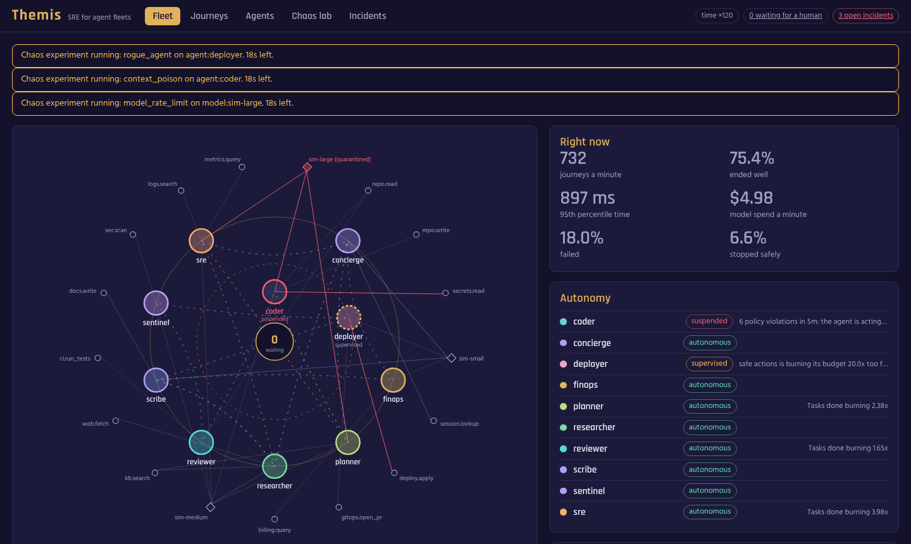

# Themis — SRE for agent fleets


**Every agent gets an error budget. An agent that spends it too fast loses autonomy: first a human approves its risky actions, then it is stopped. Themis also tells you which agent, tool or model broke a user's request, and it proves all of this by breaking things on purpose.**
It runs with no cloud, no API key and no Docker. Any agent that already emits OpenTelemetry works with two environment variables.



The human is at the centre. The less an agent is trusted, the closer it is pulled in.

```text
$ themis bench
warm-up  30s of healthy traffic
chaos   model_rate_limit on model:sim-large at 80% for 40s
        response: dependency quarantined, callers on fallback after 3.96s
        fleet is calm again
chaos   tool_wrong_result on tool:kb.search at 60% for 40s
        response: dependency quarantined, callers on fallback after 15.37s
        fleet is calm again
chaos   context_poison on agent:coder at 60% for 40s
        response: agent moved to suspended after 4.7s
        fleet is calm again
chaos   rogue_agent on agent:deployer at 30% for 40s
        response: agent moved to supervised after 3.99s
        fleet is calm again
ingest   60,000 spans from 4 clients
```

## What it does

- **Error-budget autonomy.** Four indicators per agent (tasks done, clean handoffs, safe actions, within cost),
  judged by the same 14.4x / 1h / 5m burn-rate rule used for services. Burn the budget and the agent moves from
  *autonomous* to *supervised* to *suspended*. Only a person un-suspends an agent.
- **Chaos for agents.** Five faults you can inject: a model answering 429, a tool that is silently wrong, a
  poisoned context, a rogue agent, a slow dependency. Each experiment is scored: how fast Themis reacted, how
  far the damage spread, and whether it named the right cause.
- **Cross-agent root cause.** When a journey fails, the cause is the earliest span with real evidence (an
  error, a failed check, a denied action, a bad handoff). When nothing errored and the answer was simply wrong,
  statistics over recent journeys find what the failures have in common.
- **Journeys, like RUM for agents.** One user request followed across every agent, model, tool and pod it
  touched, with time, tokens and cost.

Tools and models that keep causing failures are **quarantined** so callers fall back, and every demotion or
quarantine goes out as an **incident** to whatever reads Alertmanager webhooks.

## Start here

This section is written for anyone. Go step by step and stop at the step you need.

### What you need

| What you want to do | What you need |
|---|---|
| **Try it** with the built-in ten-agent world | Python 3.11 or newer, Git |
| **Watch your own agents** | agents that emit OpenTelemetry GenAI spans (agent-harness-sdk does already) |
| **Run it for a team** | Postgres |
| **Run it highly available** | Kubernetes and Postgres. The manifests are in `deploy/kubernetes` |
| **Send incidents somewhere** | anything that accepts Alertmanager webhooks: Aegis War Room, Argus, Alertmanager tooling |

On Windows, use WSL2.

### Step 1: try it (2 minutes, nothing else needed)

```bash
git clone https://github.com/debanjan0212/themis-agent-sre.git
cd themis-agent-sre
python3 -m venv .venv && source .venv/bin/activate
pip install -e ".[dev]"

themis demo
```

It prints a link. Open it. You are looking at ten simulated agents (a concierge, a planner, a coder, a
reviewer, a deployer and so on) serving simulated users. The models and tools are simulated; everything
around them is real: real OpenTelemetry spans over real HTTP into the real control plane.

- **Fleet** is the live map. **Journeys** is every user request. Click one to see what it used.
- **Agents** shows each agent's targets and how much error budget is left.

### Step 2: break it on purpose

```bash
themis demo --chaos
```

After 25 healthy seconds it injects four faults, one after another, and prints what Themis did about each.
Keep the Fleet page open and watch: the deployer is pulled to the inner ring, the coder docks at the centre,
the model on the outer ring turns red. Time is compressed 120x in the demo, so a one-hour window passes in 30 seconds.

Or pick your own from the **Chaos lab** page, or the terminal:

```bash
export THEMIS_KEY=<the key from the demo link, the part after key=>
themis chaos rogue_agent agent:deployer --intensity 0.3 --duration 40
```

### Step 3: watch your own agents

```bash
themis serve                        # terminal 1: Themis on http://localhost:8600, data in ./themis.db
themis key --scopes admin           # terminal 2: a key for you. Paste it into the dashboard
themis key --scopes ingest          # and a key for your agents. Each key is printed once

export OTEL_EXPORTER_OTLP_ENDPOINT=http://localhost:8600
export OTEL_EXPORTER_OTLP_HEADERS="Authorization=Bearer%20<the ingest key>"
# now run your agent as usual, in the same terminal
```

With [agent-harness-sdk](https://github.com/debanjan0212/agent-harness-sdk) that is everything. For other
frameworks, [docs/TELEMETRY.md](docs/TELEMETRY.md) lists the span attributes Themis reads. Prompts and tool
payloads are dropped on arrival unless you turn storage on.

### Step 4: let Themis control them

Seeing is half of it. To make demotion mean something, your agent runtime asks the gate before it acts:

```python
from themis.client import Gate

gate = Gate("http://localhost:8600", ingest_key)
gate.start()
gate.autonomy("deployer")  # "autonomous", "supervised" or "suspended"
gate.allowed("deployer", "tools", "deploy.apply")  # is it on the agent's allow-list?
await gate.approve("deployer", "tool:deploy.apply", {"change": "..."})  # waits for a human; no answer is a no
```

The full pattern is in [docs/INTEGRATION.md](docs/INTEGRATION.md). If Themis is unreachable the gate keeps its
last answer, so your agents do not stop because the control plane did.

### Step 5: send incidents to people

```bash
export THEMIS_WEBHOOKS="http://localhost:8000/api/alerts"    # Aegis War Room, for example
export THEMIS_WEBHOOK_ALLOW_PRIVATE=1    # needed for localhost and in-cluster addresses; off by default
themis serve
```

A suspended agent then opens a war-room incident in [Aegis](https://github.com/debanjan0212/aegis-war-room),
or starts an investigation in [Argus](https://github.com/debanjan0212/argus-sre-agent).

### Step 6: run it for real

```bash
pip install -e ".[postgres]"
export THEMIS_DB_URL=postgresql+psycopg://themis@db.internal/themis
themis key --scopes admin           # your first key
themis serve --host 0.0.0.0
```

Run as many replicas as you like against the same Postgres. They all take traffic; one of them leads the
evaluator and another takes over if it dies. For Kubernetes, `deploy/kubernetes` has the manifests: 3 to 8
replicas across zones, a disruption budget, an autoscaler, a canary rollout judged against Themis's own SLO, and
a network policy. They are rendered by [IntentOps](https://github.com/debanjan0212/intentops) from
`deploy/intent.yaml`; change that file and run `make render`. Every setting is in
[docs/CONFIGURATION.md](docs/CONFIGURATION.md) and day-two operations are in [docs/RUNBOOK.md](docs/RUNBOOK.md).

## What was measured

`themis bench` runs the four faults under load and writes [docs/RESULTS.md](docs/RESULTS.md) from what it
measured. From the run in this repository (3,862 journeys from 16 simulated users, on PostgreSQL, x86_64, 2 CPUs, Python 3.13.18):

| Fault injected | What Themis did | Reacted in | Journeys failing, before → after | Cause named correctly |
|---|---|---|---|---|
| `model_rate_limit` on `model:sim-large` | dependency quarantined, callers on fallback | 3.96s | 31% → 10% | 57 of 57 |
| `tool_wrong_result` on `tool:kb.search` | dependency quarantined, callers on fallback | 15.37s | 45% → 14% | 128 of 133 |
| `context_poison` on `agent:coder` | agent moved to suspended | 4.7s | 19% → 2% | 230 of 230 |
| `rogue_agent` on `agent:deployer` | agent moved to supervised | 3.99s | 6% → 2% | 164 of 164 |

Across all four, the cause was named correctly for **632 of 638** failed or stopped journeys. The rogue agent got 2 unsafe actions through before it was supervised and 1 after. Ingest took 15,790 spans a second on one process.

The models and tools in that run are simulated, so read the accuracy as an upper bound until it is measured
on real traffic. The control plane in that run is the production code.

## How it fits with the other repositories

| Repository | Its job | With Themis |
|---|---|---|
| [agent-harness-sdk](https://github.com/debanjan0212/agent-harness-sdk) | Build agents, OpenTelemetry built in | Its agents appear in Themis with no code change |
| [aegis-war-room](https://github.com/debanjan0212/aegis-war-room) | A team of agents investigates; a human says go or no-go | Receives Themis incidents |
| [argus-sre-agent](https://github.com/debanjan0212/argus-sre-agent) | Alert → root cause → fix as a pull request | Receives Themis incidents |
| [intentops](https://github.com/debanjan0212/intentops) | Describe a service once, run it anywhere | Plans and renders Themis's deployment |

Those make agents do SRE work. Themis does SRE work on the agents. `make ecosystem` clones all four at pinned
commits and tests the connections for real; nothing in those tests is mocked.

## Security

Keys are scoped (agents, dashboard, operators, admins), stored as hashes and revocable. Tenants are isolated.
Telemetry is treated as untrusted input everywhere, including in the dashboard. Every rule has a test, and
[SECURITY.md](SECURITY.md) lists them next to the OWASP Top 10 for Agentic Applications, with the gaps.
`make scan` runs Bandit and pip-audit; CI adds gitleaks, Trivy and CodeQL.

## What it does not do yet

- The gate is advisory. A runtime that ignores it is not stopped. Enforce it where your agents call tools.
- Agents share one ingest key per tenant, so spans are not tied to an agent's identity.
- The measured results come from a simulator. Real models have not been run through the benchmark yet.
- The container image is built and started by CI; it was not built on the machine this version was written on.

The plan for each of these is in [docs/ROADMAP.md](docs/ROADMAP.md).

## More

| | |
|---|---|
| [docs/ARCHITECTURE.md](docs/ARCHITECTURE.md) | how it works, high availability, the decisions and their costs |
| [docs/API.md](docs/API.md) | every route and scope |
| [docs/TELEMETRY.md](docs/TELEMETRY.md) | the span attributes Themis reads |
| [docs/INTEGRATION.md](docs/INTEGRATION.md) | your agents, the gate, the sibling projects, Prometheus |
| [CONTRIBUTING.md](CONTRIBUTING.md) | branches, what a change needs, where things are |

`make check` runs everything CI runs. `python scripts/film.py out/` re-records the demo video from a live run.

MIT licence. The dashboard's typefaces, Rajdhani and Hind by Indian Type Foundry, are under the SIL Open Font
Licence (`themis/web/fonts/`).
