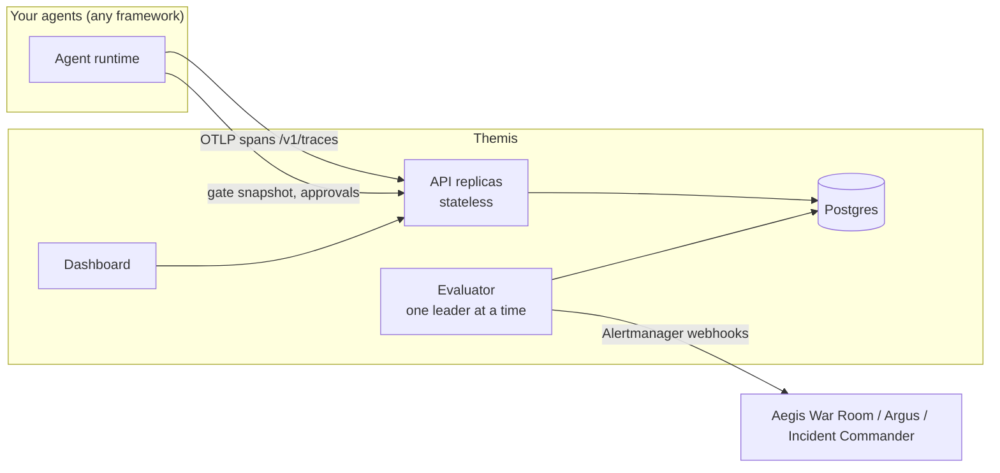

# How Themis works

Themis is a control plane. Your agents keep running where they run today. They send Themis ordinary
OpenTelemetry spans, and they ask Themis's gate what they are currently allowed to do.

## The path of one journey

1. **Ingest** (`themis/otlp.py`, `POST /v1/traces`). Any replica accepts OTLP/HTTP (protobuf or JSON), turns each
   span into one row and appends it. Ingest never updates anything, so replicas never fight.
2. **Judge** (`engine.finalise`). A moment after a root span ends, the evaluator loads the whole trace, decides the
   outcome (`success`, `failed` or `blocked`), prices the model calls, works out which agent each span belongs to,
   and looks for the root cause in the evidence (`themis/rca.py`).
3. **Count** (`engine._account`). Each agent task, handoff and high-risk action becomes a good or bad event in a
   small time bucket. SLO windows are sums over buckets, so evaluating them stays cheap however many spans arrive.
4. **Decide** (`themis/slo.py`, `themis/autonomy.py`). Multi-window burn rates (14.4x over 1h and 5m, 6x over 6h
   and 30m) move agents down the autonomy ladder. Good behaviour moves a supervised agent back up. Nothing but a
   person un-suspends an agent.
5. **Quarantine** (`engine.evaluate_quarantine`). A tool or model that is named as the cause of enough recent
   failures is quarantined with a time limit that doubles on each repeat, like a circuit breaker.
6. **Publish** (`GET /v1/gate/snapshot`). Runtimes poll one small document: each agent's level and allow-lists,
   what is quarantined, the fallbacks, and any chaos faults to apply. They decide locally from it.
7. **Tell people** (`engine.notify`). Demotions and quarantines open incidents, sent as Alertmanager-format
   webhooks, at least once, outside any database transaction.

## Root cause in two steps

- **Evidence.** A span with an error, a failed check, a denied action or an invalid handoff is a signal. Errors
  travel upwards and forwards, so the cause is the earliest signalled span with no signalled span beneath it.
  An invalid handoff blames the sender, not the agent that choked on it. A failed check blames the tool, unless
  the check says the caller misused it.
- **Statistics.** Some failures leave no signal: every span is green and the answer is wrong. For those Themis
  scores each component by *how much likelier a journey fails when it is used* times *how many of the
  unexplained failures it covers*. Only failures with no evidence go into this, so an explained failure cannot
  point at an innocent neighbour.

## High availability

- **API replicas are stateless.** Run as many as you like behind a Service. In-memory state is only caches with
  a short life (keys 5s, snapshot 0.5s, overview 1s) and the per-replica rate limiter.
- **One evaluator leads.** Every replica runs the evaluator thread; a lease row in the database decides which
  one works (`db.take_lease`). Each process holds it under its own name (the instance name plus a random part),
  so two replicas can never both lead. A leader that is stopped gives the lease up on the way out and the others
  check every second, so a rolling deploy hands over in about a second. A leader that crashes cannot give it up:
  another takes over when the lease expires, after three intervals.
  `test_two_replicas_share_the_work_and_survive_losing_the_leader` kills the leader and checks this on SQLite and
  Postgres.
- **Nothing is counted twice.** A journey is claimed (`done = true` where it was false) in the same transaction
  that counts it, so a leader that lost the lease in the middle of a tick gets nothing from its claim.
- **Overload and outages answer 503.** A database that is unreachable or out of connections is answered `503`
  with `Retry-After`, which OpenTelemetry exporters retry. Requests wait at most 5 s for a connection rather than
  pile up.
- **Replicas can start together.** Schema creation on Postgres takes an advisory lock, so replicas starting at
  the same moment on an empty database do not race.
- **Measured.** [RELIABILITY.md](RELIABILITY.md) is a soak run against all of this: a crashed leader, a rolling
  restart and a database outage under load.
- **The data plane does not depend on the control plane being up.** A runtime keeps its last snapshot if Themis
  is unreachable. Only high-risk approvals fail closed.
- **Postgres is the one stateful part.** Use a managed, replicated Postgres. Themis adds no other moving parts:
  no queue, no cache server.

`deploy/kubernetes` (rendered by IntentOps from `deploy/intent.yaml`) runs 3 to 8 replicas across zones with a
disruption budget, an autoscaler, a canary rollout judged against Themis's own SLO, and a locked-down network policy.

## Decisions, and what they cost

| Decision | Why | Cost |
|---|---|---|
| Plain OTLP in, GenAI semantic conventions | Any agent that already emits OpenTelemetry works with two environment variables | The conventions are still "Development" status, so attribute names can change; `docs/TELEMETRY.md` lists what is read |
| Gate decisions are made in the runtime from a snapshot | No network call on the hot path; agents survive a Themis outage | A change takes up to about a second to reach an agent. The benchmark shows it as a handful of actions slipping through |
| SLIs are counted when a journey is judged, not when a span arrives | The whole trace is needed to know who owns a span and whether an action was denied | Detection waits `settle_seconds` plus one evaluator interval |
| Dashboard with no build step and no framework | `pip install` is the whole install; one fewer supply chain | Hand-written DOM code; fine at this size |
| Synchronous SQLAlchemy Core | Simple, and the same SQL on SQLite and Postgres | One evaluator thread; see the limits below |

## Limits marked in the code

Search for `shortcut:` to find them. Each names its limit and when to upgrade.

- The last hour of journeys is scored for statistics in memory, capped at 20,000 (`engine.recent_journeys`).
- The rate limiter counts per replica (`security.RateLimiter`).
- A revoked key lives up to 5 seconds on other replicas (`api.key_revoke`).
- A trace whose root span never arrives is never judged. Its spans are pruned at retention.
- One evaluator thread judges about 400 journeys per database round trip. Past roughly a few hundred journeys a
  second, shard the evaluator by tenant.
